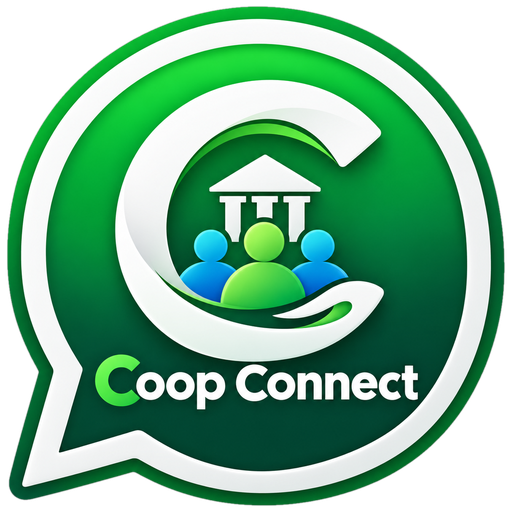

# Coop Connect

<p align="center"></p>

A WhatsApp-style chat and file-sharing app for your co-op. It runs on a PC or a
cloud server, and people use it from any browser on a PC, laptop or phone, on any
network: office LAN, home Wi-Fi or mobile data.

## Features

- **Accounts:** sign up with full name, username and password; log in with username and password
  - Usernames are unique (3–20 letters, numbers, `.` or `_`), and passwords are stored hashed (scrypt)
  - You stay logged in for 30 days. You can change your password from your profile, which logs out your other devices
  - Repeated wrong passwords are blocked for 15 minutes
- **Chats:** one-to-one chats and group chats
- **Voice & video calls:** one-to-one, with mute, camera on/off, ringing, and call history (missed / declined / duration) in the chat
  - **🖥 Screen sharing** during any call (from a PC browser): show a document or report to the other person; phones can watch
- **Sharing:** photos, videos, audio, PDFs, Word/Excel and any other file, up to 100 MB each
  - Send them with the 📎 button, drag & drop or paste (Ctrl+V)
  - A shared file can only be opened by people in the chat it was sent to
- **📍 Location:** from the 📎 menu, send your current location, or share **live location** for 15 minutes, 1 hour or 8 hours
  - Shown on a small OpenStreetMap map with "Open in Google Maps"; live maps move as you move and show when they were last updated
  - Stop sharing at any time; it ends by itself when the time is up. Keep Coop Connect open on the sharing device
- **📸 WebSnap:** take a live photo with the PC's webcam (or phone camera) right inside the chat
  - Live preview, 3-second timer, switch camera, retake, add a caption, send
  - The photo is marked "📸 WebSnap" so everyone knows it was taken just now, not picked from old files
  - Like calls, it needs the `https://` link and permission to use the camera
- **Status:** sent / delivered / read ticks, online and "last seen", and "typing…"
- **Messages:** reply, copy, **delete for me** (any message) and **delete for everyone** (your own; removes the shared file too)
- **Chat menu (⋮):** contact/group info, **clear chat** (empties it for you only), **delete chat**, exit group
- **Extras:** an emoji picker, clickable links, unread counts, search and desktop notifications
- **About (status):** WhatsApp-style moods like 🟢 Available, 🤝 In a meeting, 🚜 On field visit, or your own text with emojis. Tap a chat's name to see someone's About
- **Report status:** under About in Profile, pick up to 3 of: `229-217-314`, `229,217-314`, `314 downloaded many times..`, `414 downloaded`
  - Tick exactly which people may see it; only they see it in your Contact info (enforced by the server, updates instantly)
- **App lock:** hide the whole app behind a plain **Secure Login** password screen that doesn't look like a chat (set a lock password per device in Profile)
  - Locks on reopening the tab and when you tap the padlock; even the browser tab title becomes "Secure Login"
  - The lock password is stored only as a hash on that device, never sent anywhere; forgetting it means clearing the site's browser data (which signs that device out)
- **Look:** professional design in the Coop Connect brand colours: split-screen sign-in, All / Unread / Groups filters, light and dark theme, and a layout that also works on phones

## 1. Try it on one PC or office network

1. Install **Node.js** (LTS) from <https://nodejs.org>.
2. Double-click **`start-coop-connect.bat`** (Windows), or run `npm install` and then `npm start`.
3. Open <http://localhost:3000>. Other PCs on the **same** network can open the
   `http://192.168.x.x:3000` address shown in the window.

## 2. Use it from anywhere (different networks)

People on other networks can't reach `localhost` or `192.168.x.x`. Pick one of these:

### Option A: Permanent link from your PC (free, recommended)

Double-click **`start-online.bat`** (Windows) or run `./start-online.sh` (macOS/Linux).
It uses [Tailscale Funnel](https://tailscale.com/kb/1223/funnel) to give your PC a public
HTTPS address that **never changes**, like `https://coop-connect.tail1234.ts.net`.

The first time only:

1. Click **Yes** when Windows asks for administrator permission.
2. Tailscale is installed for you. Sign in in the browser window that opens, with any
   Google, Microsoft, Apple or GitHub account. It's free.
3. If Tailscale shows a link to **enable Funnel**, open it and click **Enable**.
4. The window prints your permanent link. Share it with everyone.

After that, just double-click `start-online.bat` whenever you start the PC, and the same
link works again. Or let it start by itself (see section 3). Keep the PC on and the *Coop Connect server* window open while people chat.

**Nicer link name:** the address is `https://<pc-name>.<tailnet-name>.ts.net`. In the
[Tailscale admin console](https://login.tailscale.com/admin/machines), rename the machine
to e.g. `coop-connect`. You can also pick a friendlier tailnet name under **DNS**. Do
this once, before you share the link.

**Turn the public link off:** run `tailscale funnel reset` in an administrator window.

**Link shows "This site can't be reached" / `ERR_CONNECTION_CLOSED`?** Double-click
**`check-online.bat`** on the server PC. It checks Coop Connect, Tailscale, the https
certificate, Funnel and whether the internet can find your link, then fixes what it can and
tells you exactly what to do for the rest. Right after Funnel is first turned on, allow
10–15 minutes for the certificate and the link name to be ready. On phones, test with
Wi-Fi off, in Google Chrome, with "Private DNS" and any VPN/ad-blocker turned off.

**Just a quick test?** `start-quick-link.bat` (or `./start-quick-link.sh`) gives a
temporary `trycloudflare.com` link with no sign-in, but it changes on every start.

**Your own domain** (like `chat.yourcoop.in`): use a
[named Cloudflare Tunnel](https://developers.cloudflare.com/cloudflare-one/connections/connect-networks/get-started/create-remote-tunnel/)
pointing at `http://localhost:3000`.

### Option B: Host it in the cloud (always on, permanent address)

**Google Cloud's free server, keeping your existing link:** follow
[docs/GOOGLE-CLOUD.md](docs/GOOGLE-CLOUD.md). `export-data.bat` packs your accounts, messages and
files on the old PC; `scripts/install-linux.sh --import coop-data-backup.zip` sets everything up on
the server, including Tailscale with the same machine name, so the link doesn't change.

Use this if the PC can't stay on. The address is fixed too.

**Render (easiest):**

1. Push this repository to GitHub.
2. On <https://render.com>, choose **New → Blueprint** and pick the repo.
   `render.yaml` sets everything up, including a disk that keeps your data.
3. Share the `https://coop-connect-xxxx.onrender.com` address.

The disk needs Render's paid *Starter* plan. On the free plan the app runs, but
messages and files are wiped whenever it restarts.

**Any server with Docker:**

```bash
docker build -t coop-connect .
docker run -d -p 3000:3000 -v coop-data:/data -e TRUST_PROXY=1 --restart unless-stopped coop-connect
```

Put it behind HTTPS (for example Caddy, Nginx or Cloudflare) before sharing the address.

## 3. Start automatically with Windows (recommended for the server PC)

Double-click **`install-autostart.bat`** once and click **Yes** for administrator permission.

It does everything in one go:

1. Coop Connect runs as a background task as soon as Windows starts, even before anyone
   logs in. There are no windows to keep open, and it restarts itself if it ever stops.
2. It sets up the permanent Tailscale link (the same steps as `start-online.bat`).
   Tailscale also starts with Windows, so the link comes back by itself after every restart.
3. It asks whether to stop the PC from sleeping while plugged in. Say **Y**, because a
   sleeping PC can't serve the link.

After that, nobody needs to start anything. Just keep the PC switched on and connected to
the internet.

- **Check what it's doing:** open `logs\server.log` in the Coop Connect folder.
- **Moved the folder or updated Node.js?** Run `install-autostart.bat` again.
- **Turn it off:** double-click **`uninstall-autostart.bat`**. Your messages and files are kept.

## Voice & video calls

Open a one-to-one chat and click 🎥 (video) or 📞 (voice) at the top. The other person
sees an incoming call screen with **Accept** / **Decline**. During a call you can mute,
turn your camera off, and hang up. Every call is noted in the chat ("Missed voice call",
"Outgoing video call 2:31"…), and you can click it to call back.

- **Calls need the `https://` link** (the Tailscale or cloud address), or `http://localhost`
  on the server PC itself. Browsers block the camera and microphone on plain `http://192.168…` addresses.
- **Allow the camera and microphone** when the browser asks the first time.
- The audio and video go **directly between the two devices**, so they don't load your server PC.
- **If calls ring but never connect** (common on some mobile-data or office networks), add a
  relay ("TURN") server. Copy `settings.example.env` to `settings.env`, fill in the
  `TURN_URLS`, `TURN_USERNAME` and `TURN_CREDENTIAL` from any TURN provider (several have
  free plans), and restart Coop Connect.
- Group calls are not supported yet.

## Settings

Put these in a `settings.env` file next to `server.js` (see `settings.example.env`), or set them as environment variables.


| Variable        | Default                          | Meaning                                          |
| --------------- | -------------------------------- | ------------------------------------------------ |
| `PORT`          | `3000`                           | Port the server listens on                       |
| `MAX_UPLOAD_MB` | `100`                            | Largest file you can share                       |
| `DATA_DIR`      | `./data`                         | Where accounts and messages are saved            |
| `UPLOAD_DIR`    | `./uploads`                      | Where shared files are saved                     |
| `TURN_URLS`, `TURN_USERNAME`, `TURN_CREDENTIAL` | (none) | Relay server for calls on strict networks |
| `STUN_URLS`     | Google's public STUN servers     | How devices discover each other for calls        |
| `TRUST_PROXY`   | `loopback, linklocal, uniquelocal` | Proxies to trust for HTTPS/IP (use `1` behind one proxy) |

## Backing up

Copy the data folder (`data/`, holding accounts and messages) and the uploads folder
(`uploads/`, holding shared files). For Docker, back up the `/data` volume.
